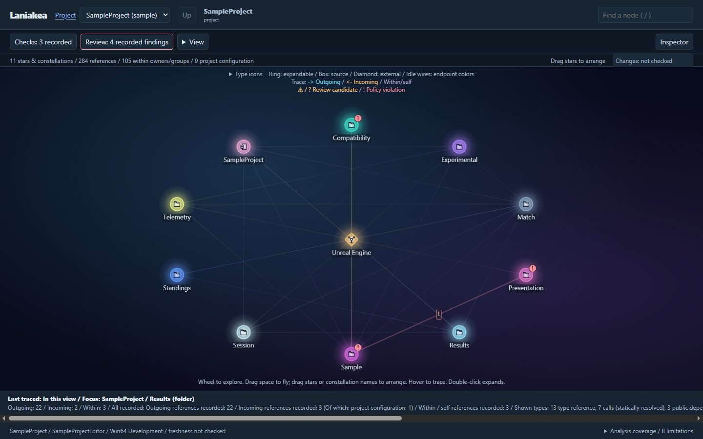
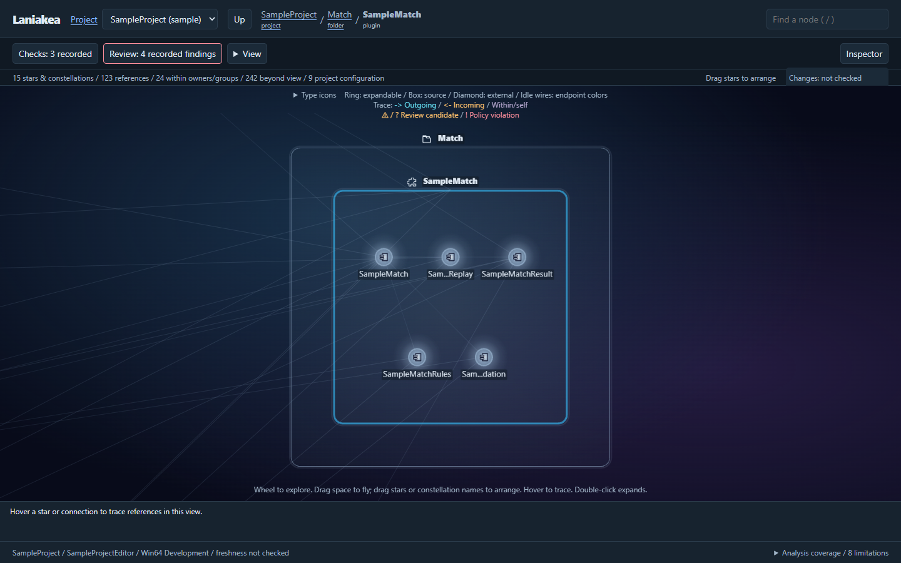

# Explore the Unreal relay sample

The [relay sample](../README.md) uses fictional relay scoring, match coordination and archive data. Follow the exercised
paths to see which findings come from build rules, static calls, and matching source tokens.



## Open the sample with default checks

Run these commands in PowerShell from the root of the Laniakea Git checkout. The copy command uses the working-tree
contents of tracked sample files and creates a new project directory. Use Windows, Git, Python 3.9+, and the Unreal 5.8
installation associated with the sample. Add `--engine <engine-root>` to Laniakea's `build` if the association does not resolve.

```powershell
$Demo = Join-Path $PWD ('workspace\tmp\r-' + [guid]::NewGuid().ToString('N').Substring(0, 8))
New-Item -ItemType Directory -Path $Demo -ErrorAction Stop | Out-Null
python sample/copy_sample.py "$Demo"
if ($LASTEXITCODE -ne 0) { throw 'Sample copy failed' }
$Project = Join-Path $Demo 'SampleProject\SampleProject.uproject'
$Run = Join-Path $Demo 'analysis'
```

Optional checks start in Auto for the new `relay-editor` target. To record all three checks, register LLVM and CPD in
`$Run` with `python laniakea.py --workspace "$Run" setup-symbols` and `python laniakea.py --workspace "$Run" setup-health`.
Add `--help` to each command for its supported version and required paths. Build `SampleProjectEditor` to create its receipt.
Set `$EngineRoot` to your installed Engine root before running the Unreal build command. If Unreal reports an action path
longer than 260 characters, repeat the copy with a shorter absolute `$Demo` path.

```powershell
& "$EngineRoot/Engine/Build/BatchFiles/Build.bat" SampleProjectEditor Win64 Development "-Project=$Project" -WaitMutex
if ($LASTEXITCODE -ne 0) { throw 'Unreal sample build failed' }
```

Publish the map, install the demonstration policy for the new target, and open the normal viewer.

```powershell
python laniakea.py --workspace "$Run" build "$Project" --name relay-editor --target SampleProjectEditor
if ($LASTEXITCODE -ne 0) { throw 'Sample analysis failed' }
$Policy = Join-Path $Run 'targets\relay-editor\review'
New-Item -ItemType Directory -Path $Policy -Force -ErrorAction Stop | Out-Null
Copy-Item -LiteralPath (Join-Path (Split-Path $Project) 'review.rules.json') `
    -Destination (Join-Path $Policy 'rules.json') -ErrorAction Stop
python laniakea.py --workspace "$Run" up relay-editor --port 0
```

The build always records module architecture. With the prerequisites above, it also collects duplicate source and the
viewer starts native indexing in the background. To begin with a module map, run the publishing block with the tools you
already have. **Checks** explains any unavailable coverage. An earlier saved sample may have duplication set to Off.
Open it normally and choose **Run recommended checks** to adopt Auto for that target.

Saved maps display their recorded runs. To explore changes to the sample, publish a new run. Restart a saved-only viewer
to load the latest publication.

Open **View** and set **Layout** to **galaxy** for the Engine-centered overview. Wheel into a constellation, hover to
trace connections, and click a wire or star to inspect its evidence. Use **Up** to return through the hierarchy.

## Record the relay path

1. Start at the project overview with Checks and Inspector closed. Hover **Results** to reveal its incoming project
   reference and its outgoing connections to **Session** and **Standings**.
2. Wheel into **Match** and expand **SampleMatch**. Pause on its five modules. Hover the coordinating module to
   show its links to validation, qualification rules, replay, and the shared result contract.
3. Search for `CloseRound` to follow the private validation call. Return to the overview, then inspect the
   **Standings** to **Match** wire to see who consumes the public result contract.
4. Finish on **Compatibility** or open its Review finding. Compare the two module-rule witnesses with the
   healthy dependency chain you just followed.

## Trace the dependencies

| Question | Follow the evidence |
|---|---|
| Why does Gameplay depend on Core? | Open **Sample**, then **SampleGameplay**. The public rule provides `FSampleProcessor` and `FSampleId` to consumers. Look up `FSampleGameplayProcessor::Process` after enabling native analysis. Its override and call to the Core base method give an example of a healthy dependency. |
| How does a round reach a replay? | Open **Match**, then **SampleMatch**. Search for `CloseRound` and follow its calls to validation, Gameplay scoring, qualification rules, and replay. Follow `Signature` across the **Telemetry** boundary to the metric derived from the shared Core round. The replay signature is deterministic and the workflow is acyclic. |
| How does the project pick a heat winner? | Search for `PreviewHeatWinner` and follow it into **Results**. **Session** closes each accepted attempt through Match. **Standings** uses Match's public result contract to order the accepted attempts by qualification, score, and missed gates. Equal results remain tied. |
| Why does Experimental have arrows in both directions? | Open **Experimental** and search for `RunStreakTrial`. It compares the Match baseline against a candidate Gameplay score and passes the result through Telemetry. In the Editor target, `TrialChangesScore` calls into the experiment. Inspect the exact module pairs to see why the arrows between **Sample** and **Experimental** are reciprocal while the module path is acyclic. |
| Do both arrows between Sample and Presentation imply a cycle? | Inspect the wire and open exact references in each direction. `SampleGameplay` privately imports `SampleHUD`, and `SampleHUD` publicly depends on `SampleCore`. Those three modules form a directed chain. The arrows are reciprocal at folder level because Core and Gameplay are both in **Sample**. |
| Where is the actual cycle? | Open **Compatibility** and **Legacy**, then drill down to the two modules in `SampleLegacy`. Both modules declare a private dependency on the other. Open the Review finding to inspect the two rule witnesses. The archive calls terminate normally. |
| What belongs to this build? | **Project** shows the selected Editor target and descriptor context. Under **Experimental**, the active trial has evaluated dependencies and **Off** contains an out-of-target plugin. **Unreal Engine** is an external boundary. The Game export leaves the Editor module and its call into the trial outside the selected target. |



In Review, open **Policy & availability** to see the [sample policy](../review.rules.json) and its
resolved scope. The Editor policy makes the Gameplay-to-HUD direction and the legacy cycle violations. Without the
policy, the witnessed cycle appears as a candidate. Open **Exact evidence** to see the rule files, then switch to
**Details** to follow the ordinary references. Acknowledge and reopen a finding to see how a decision affects badges
and the active list.

## Inspect native calls and duplicated code

Wait for **Checks** to show **C++ usage and references** and **Duplicated code** as recorded. If you added the tools or
created the build receipt after opening the map, choose **Recheck enabled checks**.

- Search for `PreviewRound`. Its inline call to `SampleRelay::Contracts::NormalizeInput` is available via the private
  Gameplay hop followed by Gameplay's public Core dependency. Follow the call to the public Core header. The nearby
  address-taking expression provides a function reference. Compare this compile access with the direct module calls.
- Search for `PreviewDisplayScore` and follow its call to `SampleHUD`. Compare the call location with the build-rule and
  descriptor references. Expand its public header and private `Relay` source folders to see the different ownership layers.
- Open the native access candidate from `SampleLegacyStats` to `SampleCore`. `ClampArchivedScore` calls the same inline
  `NormalizeInput` helper through a raw include directory in `SampleLegacyStats.Build.cs`. The build succeeds and Review
  finds no supporting recorded module path. Compare that witness with the supported call from `PreviewRound`.
- Open the duplication candidate for `SampleRelayScore.cpp` and `SampleRelayDisplay.cpp`. Choose **Compare matches**
  and read both highlighted `NormalizeRelayScore` ranges. Strings and labels in the map are only navigation aids. The ranges
  and recorded token match are the evidence.
- If Checks reports incomplete or unavailable evidence, use its displayed reason. In Review, **Policy & availability**
  shows the coverage and limits of each check for the selected run.

## Repair one boundary and recheck

Use only the disposable project. Remove `PreviewDisplayScore` from the Gameplay header and implementation, remove its HUD
include, and remove the `SampleHUD` dependency from Gameplay's `Build.cs` and `.uplugin`. `DisplayScore` still belongs to
Presentation. The duplicate normalization remains a separate problem.

Reopen **Compare matches** in the saved run before rebuilding. The edited Gameplay range is marked stale, while the
unchanged HUD range still matches its recorded source hash.

Keep the normal viewer open and inspect the changed inputs in Checks. Rebuild the Editor target to refresh native build
evidence. Open **Checks**, expand **Check settings**, and choose **Recheck current settings**.
The Gameplay-to-HUD witness disappears, the legacy findings and source match stay, and the
camera and surviving pins can be compared across the two published runs.

## Repair the duplicate scoring rule

Start with a fresh disposable copy and wait for the duplicate scoring and display ranges to appear in **Compare matches**.
Return to the overview, close the side panels, and drag **Telemetry** to pin it. Keep the viewer tab open.

1. Move one `NormalizeRelayScore` definition to `SampleCore`, in a new `Public/Relay/SampleRelayScoreNormalization.h`
   under the module. Include `Math/UnrealMathUtility.h` and make the function `inline` in `SampleRelay::Contracts`.
2. Remove both private copies. Include the new header in the scoring and display source files and call
   `Contracts::NormalizeRelayScore` from both. The existing Gameplay and HUD dependencies already provide access to Core.
3. Open **Compare matches** on the saved run. Both edited ranges report that the source changed. Rebuild the Editor
   target, return to the map, and choose **Recheck current settings** in **Check settings** from the same tab.
4. After the new map arrives, check that Telemetry is still pinned in place. Review no longer lists the matching pair.
   The Gameplay-to-HUD violation and the legacy findings still have their own evidence.

## Compare with the Game target

Build the `SampleProject` Game target using the same Unreal command with `SampleProject` in place of `SampleProjectEditor`.
Publish its map as a separate target, then restart the viewer so its target list includes both runs.

```powershell
python laniakea.py --workspace "$Run" build "$Project" --name relay-game --target SampleProject
if ($LASTEXITCODE -ne 0) { throw 'Game analysis failed' }
python laniakea.py --workspace "$Run" down
python laniakea.py --workspace "$Run" up relay-game --port 0
```

Use the target selector to compare Game and Editor coverage. Stop the viewer with Ctrl+C in its terminal or run
`python laniakea.py --workspace "$Run" down`.
